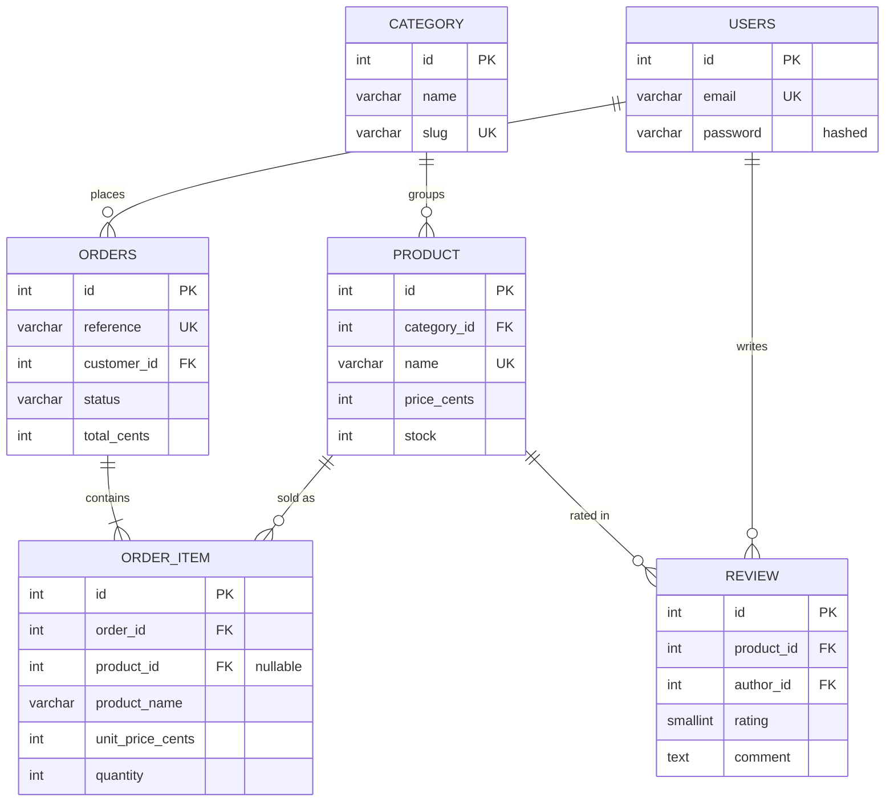

# FIGURAMA

Online shop for collectible figurines built with **Symfony 7.4**: catalogue, cart, Stripe payment, verified reviews and a back office.
*Boutique en ligne de figurines de collection.*

**[Try the live demo](https://puremax-lab.alwaysdata.net/figurama)**: log in with `client@figurama.test` (customer) or `admin@figurama.test` (back office), password `password`. Payment runs in demo mode, no card needed.


## The idea

Figurines are scale models, so the shop looks like an engineering drawing (blue grid, reference codes, dimension lines) with a touch of retro fanzine (price stickers, "sold out" stamps).

## Features

**Customers**
- Search, filter by series, sort by price; more pieces load automatically while scrolling
- One-click add to cart from the catalogue, with a side drawer that opens without leaving the page
- Product page with a technical sheet and verified reviews
- Checkout with **Stripe Checkout** (test mode), or a built-in demo payment when no Stripe key is set
- Order history, pay later, cancel an unpaid order

**Admin**
- Dashboard: revenue, orders to ship, low stock
- Product management and order statuses (paid → shipped → delivered, or cancelled)

## Technical highlights

- **Stock reserved when the order is placed** ([`OrderWorkflow`](src/Order/OrderWorkflow.php)), inside a database transaction, so two customers cannot buy the last piece. Cancelling gives the stock back.
- **Order life cycle as a PHP enum** ([`OrderStatus`](src/Entity/OrderStatus.php)) that refuses impossible changes.
- **Prices in cents**, copied into each order line, so a price change never alters a past order.
- **Stripe without the SDK** ([`StripeClient`](src/Payment/StripeClient.php)): Checkout sessions through Symfony HttpClient and a webhook with **signature verification**, safe to receive twice.
- **Verified reviews**: only customers whose order was delivered can review a piece, once.
- **Quick add and infinite scroll** in plain JavaScript ([`app.js`](assets/app.js)): the server returns JSON or HTML fragments, and everything still works without JavaScript.
- **Security**: CSRF tokens, login throttling, hashed passwords, and a voter so customers only see their own orders.

## Screens

| Product page | Cart drawer |
|---|---|
|  |  |

| Payment | Back office |
|---|---|
|  |  |

| Phone: catalogue | Phone: product |
|---|---|
|  |  |

## Data model



- An order line keeps the name and price at the time of the order; it stays if the product is deleted.
- One review per customer and product (`UNIQUE (product_id, author_id)`).

## Run it locally

**Requirements:** PHP 8.2+ with `intl` and `pdo_sqlite`, and [Composer](https://getcomposer.org). The database is a SQLite file.

```bash
git clone https://github.com/puremax-lab/Figurama.git
cd Figurama
composer install
php bin/console doctrine:migrations:migrate -n
php bin/console doctrine:fixtures:load -n
php -S 127.0.0.1:8000 -t public public/index.php
```

Open http://127.0.0.1:8000 and log in with `client@figurama.test` (customer) or `admin@figurama.test` (back office), password `password`.

For the real Stripe page, add your test keys (`STRIPE_SECRET_KEY`, `STRIPE_WEBHOOK_SECRET`) to `.env.local` and pay with the card `4242 4242 4242 4242`.

**Tests:** `php bin/phpunit` runs the whole purchase flow, reviews, permissions and the Stripe client (mocked, never the real API).

## Credits

Product photos from [Unsplash](https://unsplash.com) ([licence](https://unsplash.com/license)).

**puremax-lab**: [github.com/puremax-lab](https://github.com/puremax-lab)
