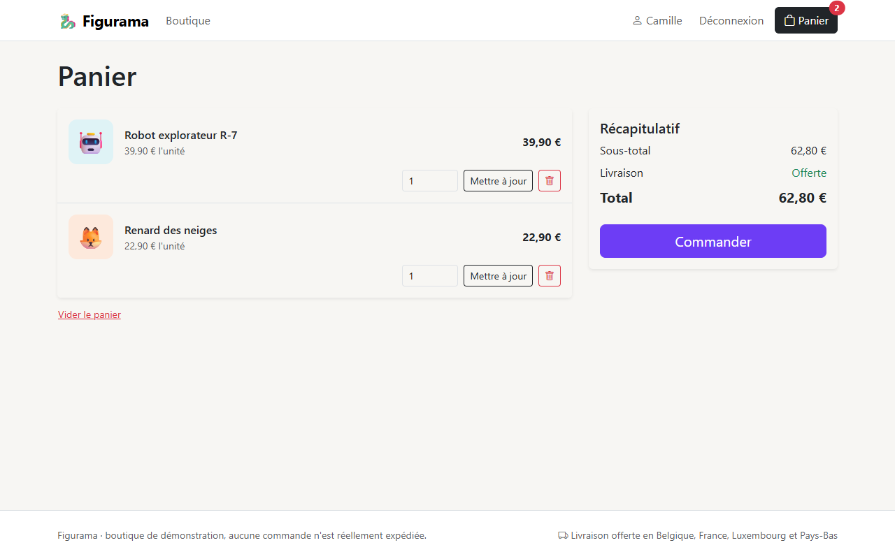
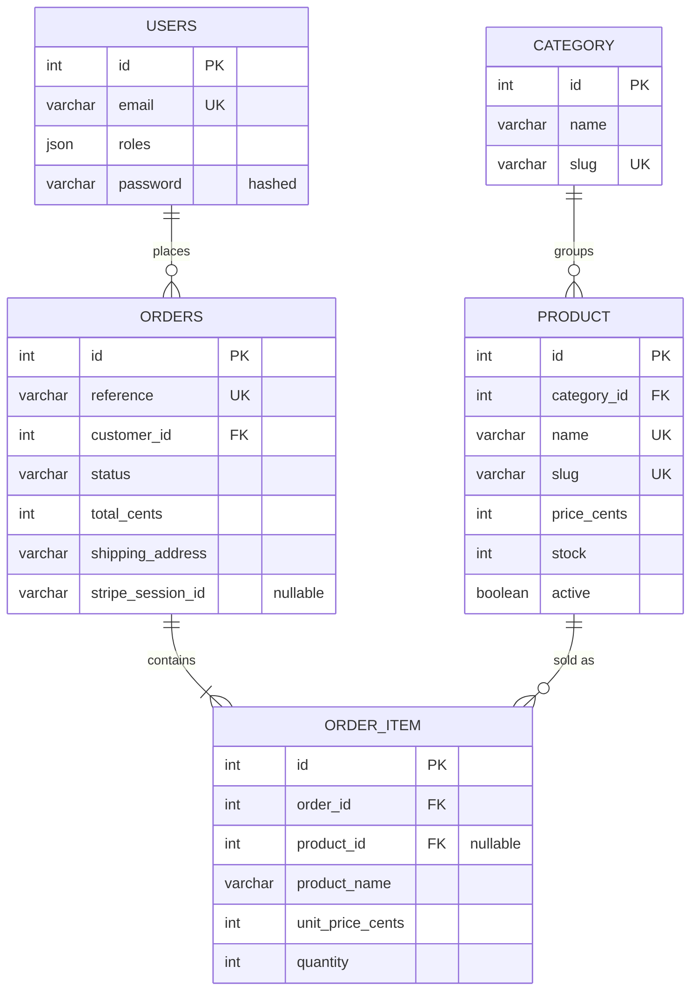

# 🐉 Figurama

**An online shop for collectible figurines, built with Symfony 7.4: catalogue, cart, Stripe payment and back office.**
*Boutique en ligne de figurines de collection, développée avec Symfony 7.4.*


## In short

| | |
|---|---|
| **What it does** | Customers browse the catalogue, fill a cart, pay with Stripe and follow their orders. Admins manage products, stock and shipping |
| **What it shows** | The core of e-commerce: a session cart, stock reservation, an order life cycle, an online payment with webhooks, and a back office |
| **Payment** | Real Stripe Checkout in test mode when a key is set, otherwise a built-in demo payment, so the shop works without any account |
| **Status** | Responsive on phones and desktops, covered by automated tests |

## Features

- **Catalogue**: categories, search, sort by price or date, "in stock only" filter, pagination, product page with similar products
- **Cart**: add, change quantities, remove; quantities can never exceed the stock
- **Checkout**: shipping address, then payment with **Stripe Checkout** (test cards) or the demo payment
- **Customer account**: order history and details, pay later or cancel an unpaid order
- **Back office**: dashboard (revenue, orders to ship, low stock), product management, order list by status, shipping and cancelling orders

## Screenshots

| Product page | Cart |
|---|---|
|  |  |

| Payment | Back office |
|---|---|
|  |  |

| Mobile: catalogue | Mobile: product |
|---|---|
|  |  |

## Technical highlights

**E-commerce logic**
- **Stock reserved when the order is placed** ([`OrderWorkflow`](src/Order/OrderWorkflow.php)), inside a database transaction (with a row lock on databases that support it), so two customers cannot buy the last item. Cancelling an order puts the items back in stock.
- **Order life cycle** as a PHP enum ([`OrderStatus`](src/Entity/OrderStatus.php)): pending → paid → shipped → delivered, or cancelled. Impossible changes (for example delivered → cancelled) are refused.
- **Prices stored in cents** to avoid rounding errors, and **copied into each order line**, so a later price change does not alter past orders.
- **Session cart** ([`Cart`](src/Cart/Cart.php)) that drops products no longer sold and lowers quantities when the stock goes down.

**Stripe integration** ([`StripeClient`](src/Payment/StripeClient.php)), written with Symfony HttpClient, without the Stripe SDK
- Creates a **Checkout session** with the order lines, then confirms the payment with the Stripe API when the customer comes back.
- **Webhook** `checkout.session.completed`, with **signature verification** (HMAC-SHA256 and timestamp check). Marking an order as paid is idempotent, since Stripe can send the same event twice.

**Security**
- Form login with **login throttling**, hashed passwords, CSRF tokens on every form that changes data (cart, payment, status changes, logout).
- **Voter** ([`OrderVoter`](src/Security/OrderVoter.php)): a customer only sees their own orders; the back office is limited to `ROLE_ADMIN`.

**Quality**
- **PHPUnit functional tests** that run the whole purchase: cart, stock limits, checkout, demo payment, cancelling, permissions, back office, and the Stripe client and webhook (with `MockHttpClient` and signed payloads, never the real API).
- **GitHub Actions** runs the tests at every push.

## Tech stack

| | |
|---|---|
| Back end | PHP 8.2+, Symfony 7.4 LTS, Doctrine ORM 3, Twig |
| Database | SQLite |
| Front end | Bootstrap 5, AssetMapper |
| Payment | Stripe Checkout (test mode), called with Symfony HttpClient |
| Tests | PHPUnit 12 |

## Database



- An order has at least one line. Each line keeps the product name and price at the time of the order.
- If a product is deleted, its order lines stay (`product_id` becomes empty).

## Run it locally

**Requirements:** PHP 8.2+ with `intl` and `pdo_sqlite`, and [Composer](https://getcomposer.org).

```bash
git clone https://github.com/puremax-lab/Figurama.git
cd Figurama
composer install
php bin/console doctrine:migrations:migrate -n
php bin/console doctrine:fixtures:load -n
php -S 127.0.0.1:8000 -t public public/index.php
```

Open http://127.0.0.1:8000. Demo accounts (password `password`): `client@figurama.test` (customer) and `admin@figurama.test` (back office).

**With Stripe (optional):** create a free Stripe account, then add your test keys to `.env.local`:

```dotenv
STRIPE_SECRET_KEY=sk_test_...
STRIPE_WEBHOOK_SECRET=whsec_...
```

Pay with the test card `4242 4242 4242 4242`, any future date and any CVC. For the webhook in local, use the [Stripe CLI](https://docs.stripe.com/stripe-cli): `stripe listen --forward-to 127.0.0.1:8000/stripe/webhook`.

**Run the tests:**

```bash
php bin/phpunit
```

## Author

**puremax-lab**: [github.com/puremax-lab](https://github.com/puremax-lab)
