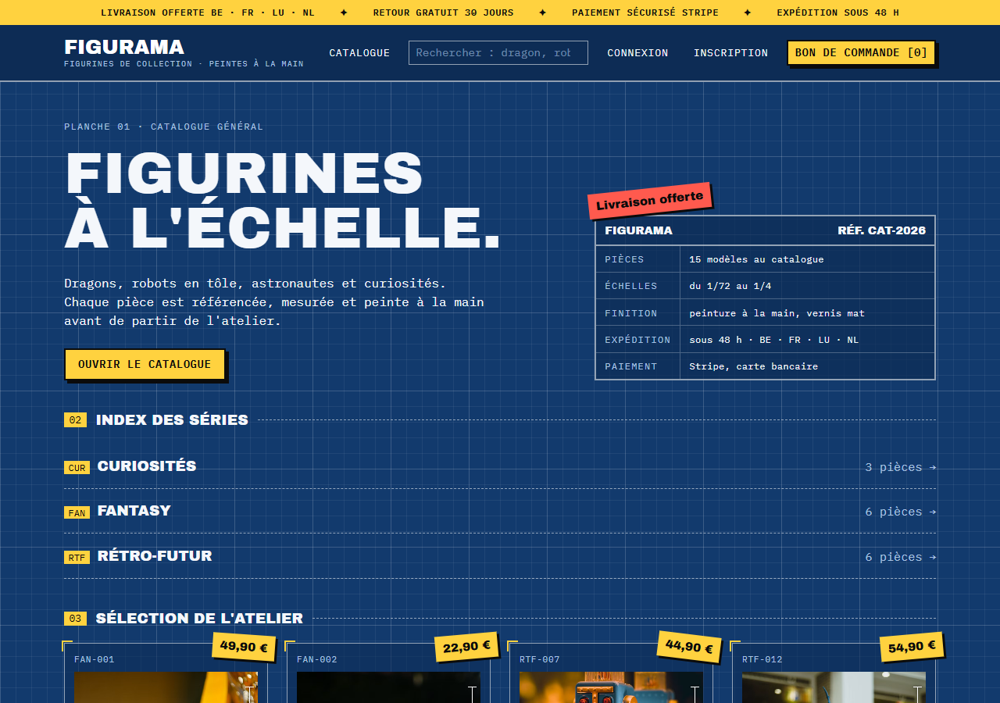
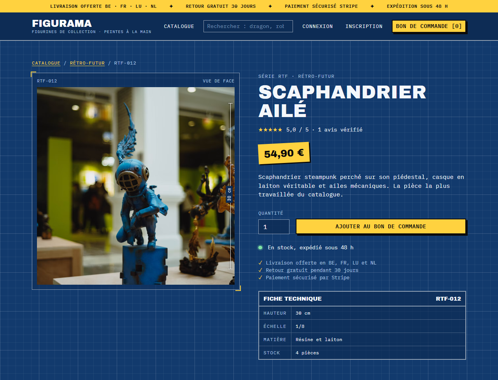
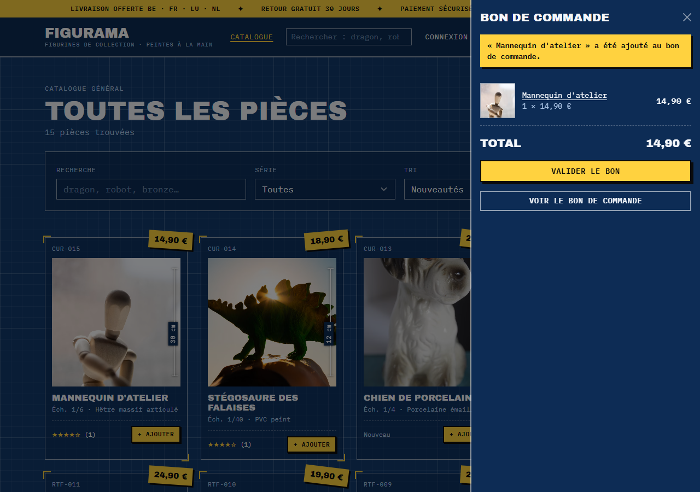
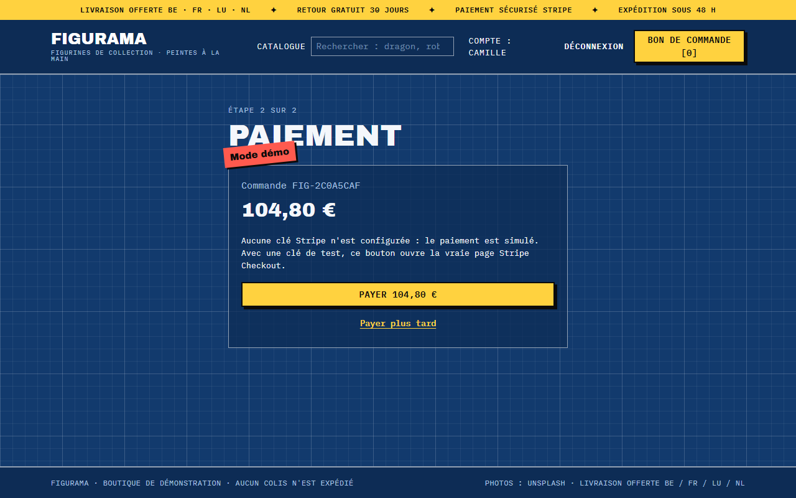
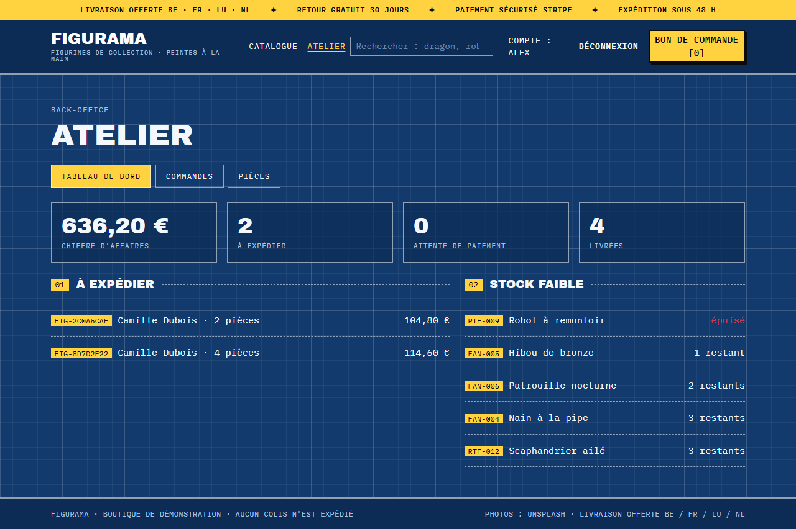
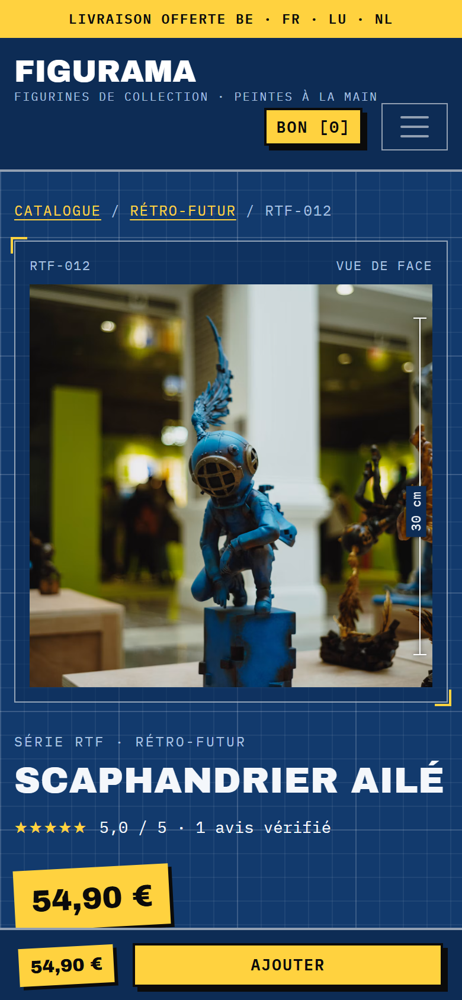
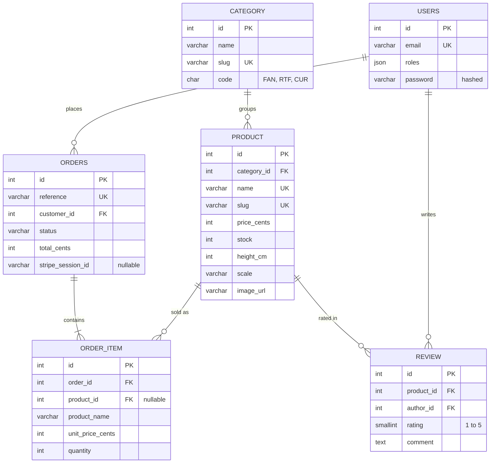

# FIGURAMA

Online shop for collectible figurines, built with **Symfony 7.4**: catalogue, cart, stock reservation, **Stripe** payment and a back office.
*Boutique en ligne de figurines de collection.*




## The idea

Figurines are scale models, so the shop is designed like an **engineering drawing**: blue gridded paper, monospaced text, a reference code for every piece (`FAN-001`), dimension lines on the photos and a technical sheet with height, scale and material. On top of that, a touch of **convention fanzine**: prices are tilted stickers, out-of-stock items get a red rubber stamp, buttons have hard shadows.

The cart is called a *bon de commande* (order form), the back office *l'atelier* (the workshop).

## What you can do

**As a customer**
- Search from any page, browse the catalogue by series, sort by price, hide out-of-stock pieces; more pieces load automatically while scrolling
- Add a piece in one click from the catalogue: the order form opens in a side drawer, without leaving the page
- Read the technical sheet and the **verified reviews** of each piece; on a phone, the buy button stays at the bottom of the screen
- Review a piece once it has been bought and paid (one review per piece)
- Enter a shipping address and pay with **Stripe Checkout** (test cards), or with the built-in demo payment when no Stripe key is set
- Follow your orders, pay later or cancel an unpaid order

**As an admin**
- See revenue, orders to ship and pieces running low
- Add and edit pieces (photo, price, stock, height, scale, material)
- Move orders through their statuses: paid → shipped → delivered, or cancelled

## Under the hood

- **Stock is reserved when the order is placed** ([`OrderWorkflow`](src/Order/OrderWorkflow.php)), in a database transaction (with a row lock on databases that support it), so two customers cannot buy the last piece. Cancelling gives the stock back.
- **Order statuses as a PHP enum** ([`OrderStatus`](src/Entity/OrderStatus.php)) that knows which changes are allowed: a delivered order cannot be cancelled, a pending one cannot be shipped.
- **Prices in cents**, copied into each order line: changing a price never changes a past order.
- **Session cart** ([`Cart`](src/Cart/Cart.php)) that removes pieces no longer sold and lowers quantities when the stock goes down.
- **Stripe without the SDK** ([`StripeClient`](src/Payment/StripeClient.php)): Checkout sessions created with Symfony HttpClient, payment checked again when the customer comes back, and a webhook whose **signature is verified** (HMAC-SHA256, 5-minute tolerance). Marking an order as paid is idempotent, because Stripe may send the same event twice.
- **Verified reviews** ([`ReviewRepository`](src/Repository/ReviewRepository.php)): only customers with a paid order containing the piece can review it, once (unique key on product + author). Average ratings for a whole page are loaded in a single query ([`Ratings`](src/Review/Ratings.php)).
- **Quick add and cart drawer** ([`app.js`](assets/app.js)): the add-to-cart forms are sent in the background, the controller answers in JSON, the counters update and a side drawer shows the order form. Without JavaScript the same forms post normally.
- **Infinite scroll without a library** ([`app.js`](assets/app.js)): an `IntersectionObserver` fetches the next page when the "load more" link gets close, and the controller returns only the new cards. Without JavaScript, the link simply opens the next page.
- **Security**: login throttling, hashed passwords, CSRF tokens on every form that changes data, and a **voter** ([`OrderVoter`](src/Security/OrderVoter.php)) so customers only see their own orders.
- **Front end**: Bootstrap provides the grid and base components, but the whole look comes from a single hand-written stylesheet ([`app.css`](assets/styles/app.css)) with IBM Plex Mono and Archivo Black.

## Screens

| Product sheet | Quick add: cart drawer |
|---|---|
|  |  |

| Demo payment | Back office |
|---|---|
|  |  |

| Phone: catalogue | Phone: product |
|---|---|
|  |  |

## Data model



A customer can review a piece only once (`UNIQUE (product_id, author_id)`). An order line keeps the name and price of the piece at the time of the order. If a piece is deleted, the line stays and `product_id` becomes empty.

## Try it

**Requirements:** PHP 8.2+ with `intl` and `pdo_sqlite`, and [Composer](https://getcomposer.org). The database is a SQLite file, nothing to install.

```bash
git clone https://github.com/puremax-lab/Figurama.git
cd Figurama
composer install
php bin/console doctrine:migrations:migrate -n
php bin/console doctrine:fixtures:load -n
php -S 127.0.0.1:8000 -t public public/index.php
```

Open http://127.0.0.1:8000 and log in with `client@figurama.test` (customer) or `admin@figurama.test` (workshop), password `password`.

To use the real Stripe page, put your **test** keys in `.env.local`:

```dotenv
STRIPE_SECRET_KEY=sk_test_...
STRIPE_WEBHOOK_SECRET=whsec_...
```

Then pay with the card `4242 4242 4242 4242`, any future date and any CVC. In local, forward the webhook with the [Stripe CLI](https://docs.stripe.com/stripe-cli): `stripe listen --forward-to 127.0.0.1:8000/stripe/webhook`.

## Tests

```bash
php bin/phpunit
```

41 functional and unit tests go through the whole purchase: search, quick add, cart and stock limits, verified reviews, checkout, demo payment, cancelling, permissions, back office, and the Stripe client and webhook (with `MockHttpClient` and signed payloads, never the real API). GitHub Actions runs them at every push.

## Credits

Product photos come from [Unsplash](https://unsplash.com) and are used under the [Unsplash licence](https://unsplash.com/license). The photo of each piece is listed in [`AppFixtures`](src/DataFixtures/AppFixtures.php).

**puremax-lab**: [github.com/puremax-lab](https://github.com/puremax-lab)
