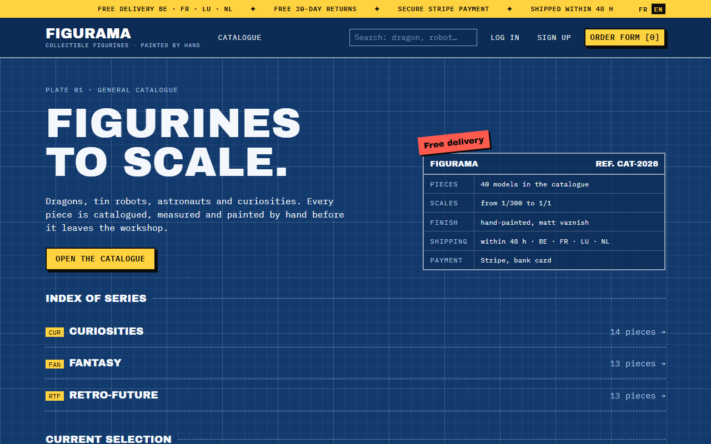
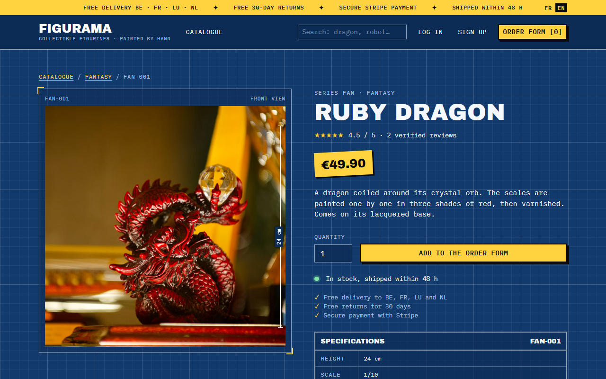
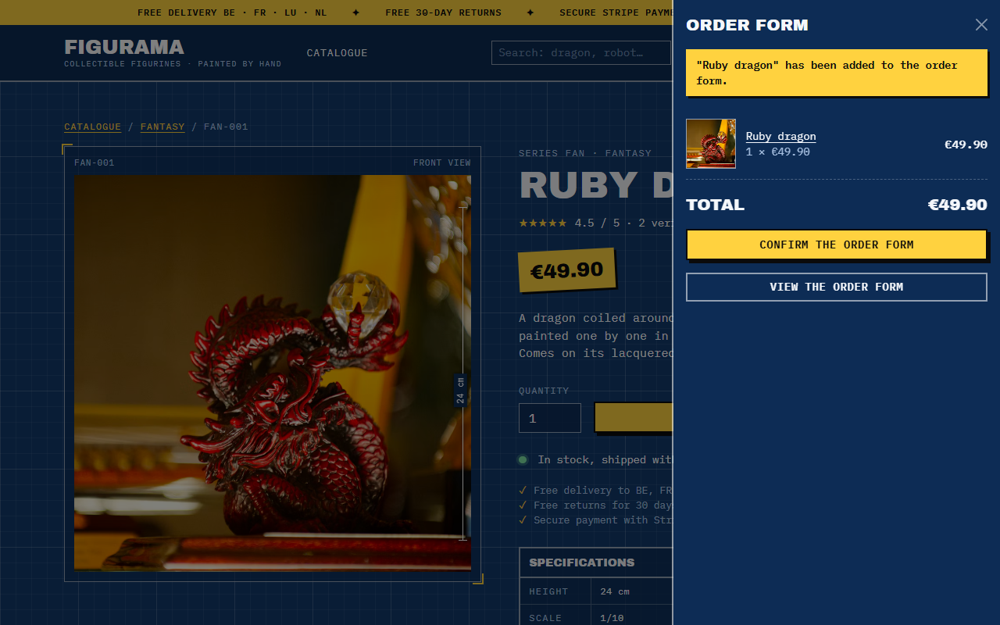
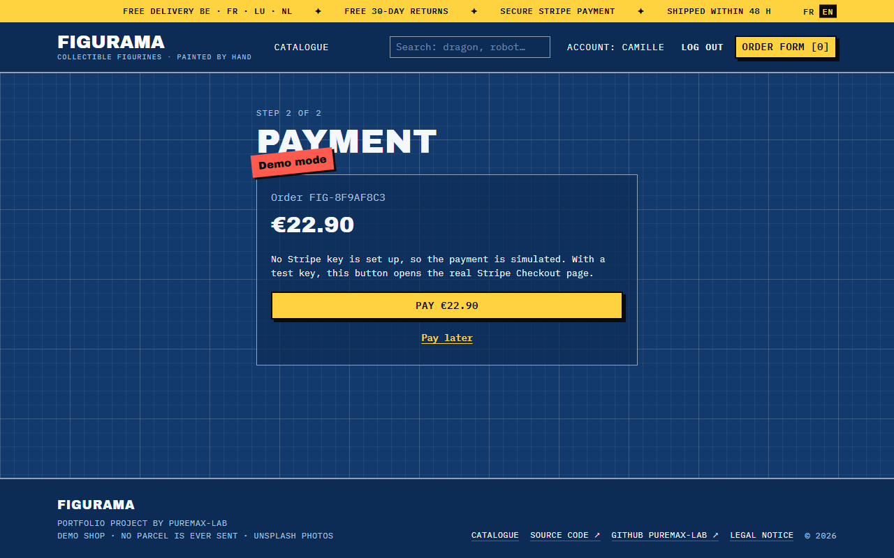
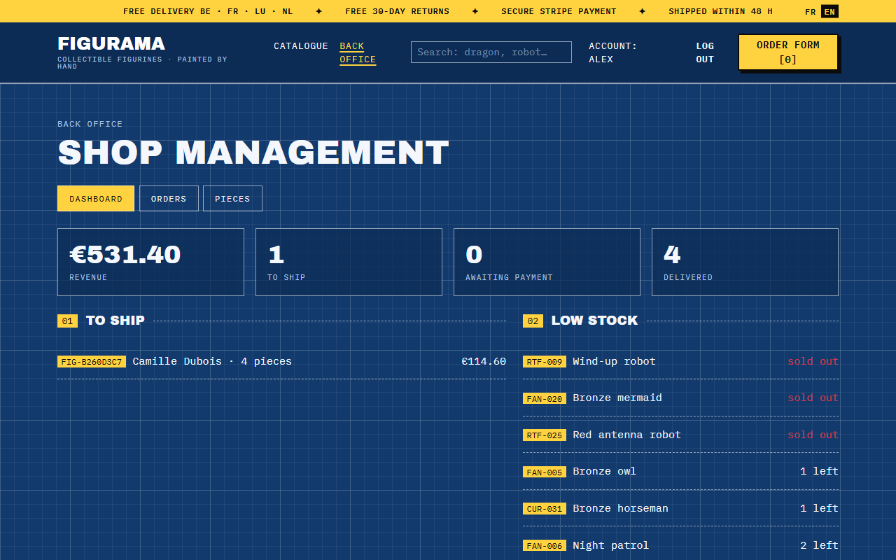
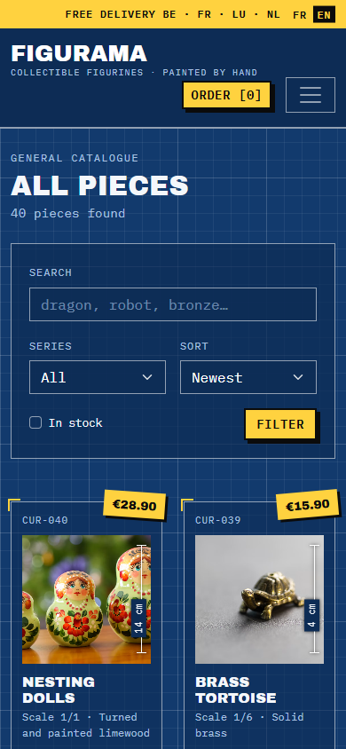
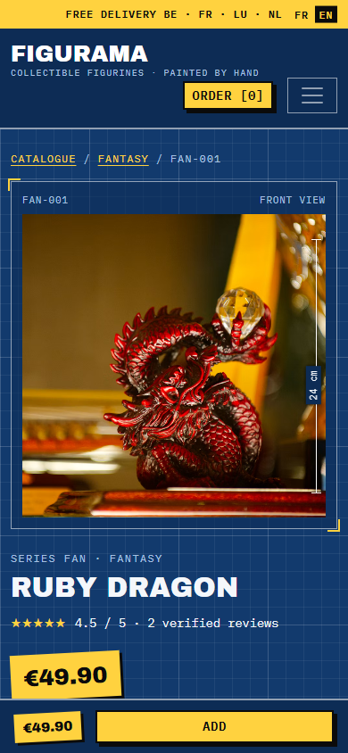
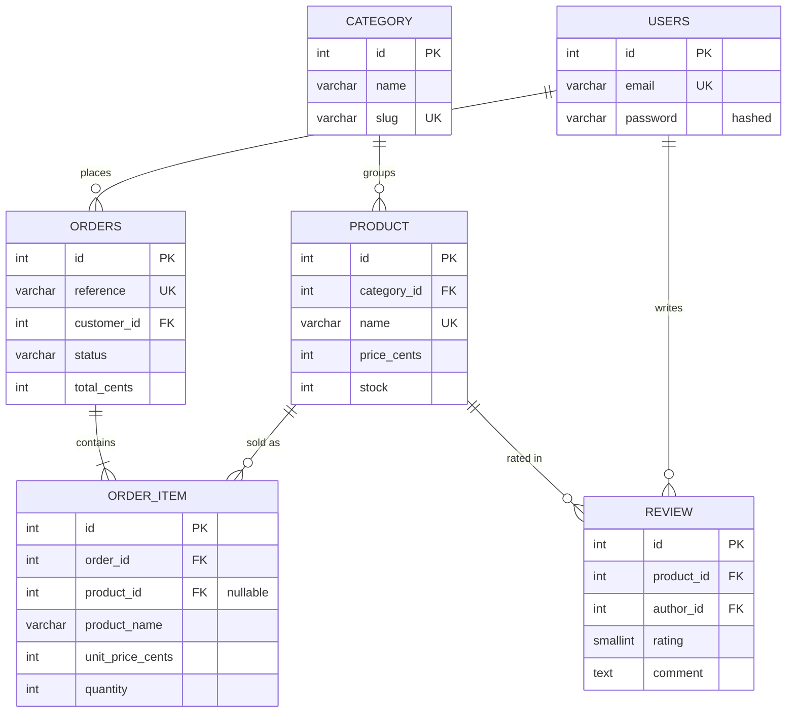

# FIGURAMA

Online shop for collectible figurines built with **Symfony 7.4**: catalogue, cart, Stripe payment, verified reviews and a back office.
*Boutique en ligne de figurines de collection.*

### 👉 [Try the live demo](https://puremax-lab.alwaysdata.net/figurama)

Log in with `client@figurama.test` (customer) or `admin@figurama.test` (back office), password `password`. Payment runs in demo mode, no card needed.


[](https://github.com/puremax-lab/Figurama/actions/workflows/tests.yml)



## The idea

Figurines are scale models, so the shop looks like an engineering drawing (blue grid, reference codes, dimension lines) with a touch of retro fanzine (price stickers, "sold out" stamps).

## Features

**Customers**
- Search, filter by series, sort by price; more pieces load automatically while scrolling
- One-click add to cart from the catalogue, with a side drawer that opens without leaving the page
- Product page with a technical sheet and verified reviews
- Checkout with **Stripe Checkout** (test mode), or a built-in demo payment when no Stripe key is set
- Order history, pay later, cancel an unpaid order
- Legal notice page (publisher, host, personal data)

**Admin**
- Dashboard: revenue, orders to ship, low stock
- Product management and order statuses (paid → shipped → delivered, or cancelled)

## Technical highlights

- **Stock reserved when the order is placed** ([`OrderWorkflow`](src/Order/OrderWorkflow.php)), inside a database transaction, so two customers cannot buy the last piece. Cancelling gives the stock back.
- **Order life cycle as a PHP enum** ([`OrderStatus`](src/Entity/OrderStatus.php)) that refuses impossible changes.
- **Prices in cents**, copied into each order line, so a price change never alters a past order.
- **Stripe without the SDK** ([`StripeClient`](src/Payment/StripeClient.php)): Checkout sessions through Symfony HttpClient and a webhook with **signature verification**, safe to receive twice.
- **Verified reviews**: only customers whose order was delivered can review a piece, once.
- **Quick add and infinite scroll** in plain JavaScript ([`app.js`](assets/app.js)): the server returns JSON or HTML fragments, and everything still works without JavaScript.
- **Security**: CSRF tokens, login throttling, hashed passwords, and a voter so customers only see their own orders.
- **Link preview**: Open Graph tags and a preview image, so a shared link shows a card on LinkedIn or in a chat.

## Stack and quality

| | |
|---|---|
| Back end | PHP 8.2+, Symfony 7.4 LTS, Doctrine ORM, Twig |
| Database | SQLite |
| Front end | Bootstrap 5, plain JavaScript, AssetMapper (no Node.js build) |
| Payment | Stripe Checkout through Symfony HttpClient |
| Tests | 43 PHPUnit tests, run on every push with GitHub Actions |
| Hosting | alwaysdata, served from a sub-folder |

## Screens

| Product page | Cart drawer |
|---|---|
|  |  |

| Payment | Back office |
|---|---|
|  |  |

| Phone: catalogue | Phone: product |
|---|---|
|  |  |

## Data model



- An order line keeps the name and price at the time of the order; it stays if the product is deleted.
- One review per customer and product (`UNIQUE (product_id, author_id)`).

## Run it locally

**Requirements:** PHP 8.2+ with `intl` and `pdo_sqlite`, and [Composer](https://getcomposer.org). The database is a SQLite file.

```bash
git clone https://github.com/puremax-lab/Figurama.git
cd Figurama
composer install
php bin/console doctrine:migrations:migrate -n
php bin/console doctrine:fixtures:load -n
php -S 127.0.0.1:8000 -t public public/index.php
```

Open http://127.0.0.1:8000 and log in with `client@figurama.test` (customer) or `admin@figurama.test` (back office), password `password`.

For the real Stripe page, add your test keys (`STRIPE_SECRET_KEY`, `STRIPE_WEBHOOK_SECRET`) to `.env.local` and pay with the card `4242 4242 4242 4242`.

**Tests:** `php bin/phpunit` runs the whole purchase flow, reviews, permissions and the Stripe client (mocked, never the real API).

## Credits

Product photos from [Unsplash](https://unsplash.com) ([licence](https://unsplash.com/license)).

Photographers of the pieces added later:

| Piece | Photographer |
|---|---|
| Licorne de porcelaine | [Annie Spratt](https://unsplash.com/photos/white-and-gold-ceramic-unicorn-figurine-near-coins-Jr8byYZmTTU) |
| Mage de bois sculpté | [David Trinks](https://unsplash.com/photos/a-statue-of-a-man-with-a-hat-and-a-cane-_eZY2eqNWkQ) |
| Fée des sous-bois | [Mamun Srizon](https://unsplash.com/photos/a-blue-flower-on-a-branch-OpUDw9RR0ys) |
| Griffon de pierre | [Deborah L Carlson](https://unsplash.com/photos/a-statue-of-a-lion-with-wings-on-top-of-a-building-1fDkObhccJc) |
| Sirène de bronze | [Alexandr Popadin](https://unsplash.com/photos/a-bronze-mermaid-figurine-sits-among-some-coins-zfHiLYHM4Tk) |
| Citadelle des neiges | [Jan-Niclas Aberle](https://unsplash.com/photos/gray-concrete-building-on-snow-covered-ground-during-daytime-NbvRZZszxZ0) |
| Fée aux fleurs | [Trac Vu](https://unsplash.com/photos/angel-holding-flowers-ceramic-figurine-zGYvSU4Uv_0) |
| Manège-fusée en tôle | [Townsend Walton](https://unsplash.com/photos/a-brightly-colored-carnival-ride-on-a-wooden-table-wpMCSvEH43c) |
| Soucoupe volante S-1 | [Alex de Koning](https://unsplash.com/photos/white-and-red-robot-toy-with-a-camera-lens-7CSP6T2_PBg) |
| Robot à antenne rouge | [Sombrero Craft](https://unsplash.com/photos/a-red-robot-figurine-with-a-microphone-on-its-head-EsuXm26FpU4) |
| Robot rouge à cadran | [Townsend Walton](https://unsplash.com/photos/a-red-toy-robot-standing-on-top-of-a-wooden-floor-Yu6BO9Mc7oQ) |
| Automobile 1910 en tôle | [Menor Degu](https://unsplash.com/photos/a-vintage-red-car-model-on-a-shelf-mNibfK5s4D0) |
| Astronaute au croissant de lune | [Kobby Mendez](https://unsplash.com/photos/astronaut-figurine-on-gold-moon-d0oYF8hm4GI) |
| Escouade de robots | [Eric Krull](https://unsplash.com/photos/blue-and-purple-robot-toy-Ejcuhcdfwrs) |
| Chat en mosaïque | [Tatiana Reusche](https://unsplash.com/photos/mosaic-cat-statue-walks-on-a-window-sill-xx2tYl1jwEA) |
| Cavalier de bronze | [The Metropolitan Museum of Art](https://unsplash.com/photos/a-bronze-statuette-of-a-knight-riding-a-horse-gYdFaICZq20) |
| Éléphant de bois verni | [asif sharif](https://unsplash.com/photos/a-wooden-elephant-figurine-sitting-on-top-of-a-wooden-table-TgMoDrvKZls) |
| Éléphant d'apparat | [Hofykz](https://unsplash.com/photos/ornate-wooden-elephant-figurine-on-a-wooden-surface-RqL4N_tZCho) |
| Grenouille couronnée | [Tim Schwaneberg](https://unsplash.com/photos/a-green-frog-statue-wearing-a-silver-crown-BPrND2YNiNY) |
| Oiseau de verre soufflé | [Leo Liu](https://unsplash.com/photos/glass-figurines-of-birds-and-vases-EA9s3n4qsm0) |
| Petits soldats d'antan | [Sahand Babali](https://unsplash.com/photos/a-toy-soldier-holding-a-gun-next-to-a-toy-soldier-Vbn9DriDqoA) |
| Maison de poupée victorienne | [Zoshua Colah](https://unsplash.com/photos/a-model-of-a-house-sitting-on-top-of-a-table-jVDIRYgUuQs) |
| Baleine de bois flotté | [Maryline Waldy](https://unsplash.com/photos/photo-of-black-whale-toy-bQez9LwXelo) |
| Tortue de laiton | [Roya Hsu](https://unsplash.com/photos/a-small-golden-turtle-figurine-on-a-grey-surface-E1UBfqYh8Tk) |
| Poupées gigognes | [Sandy Millar](https://unsplash.com/photos/a-group-of-three-nesting-dolls-sitting-on-top-of-a-wooden-table-5PCeHBkMCmk) |

**puremax-lab**: [github.com/puremax-lab](https://github.com/puremax-lab)
